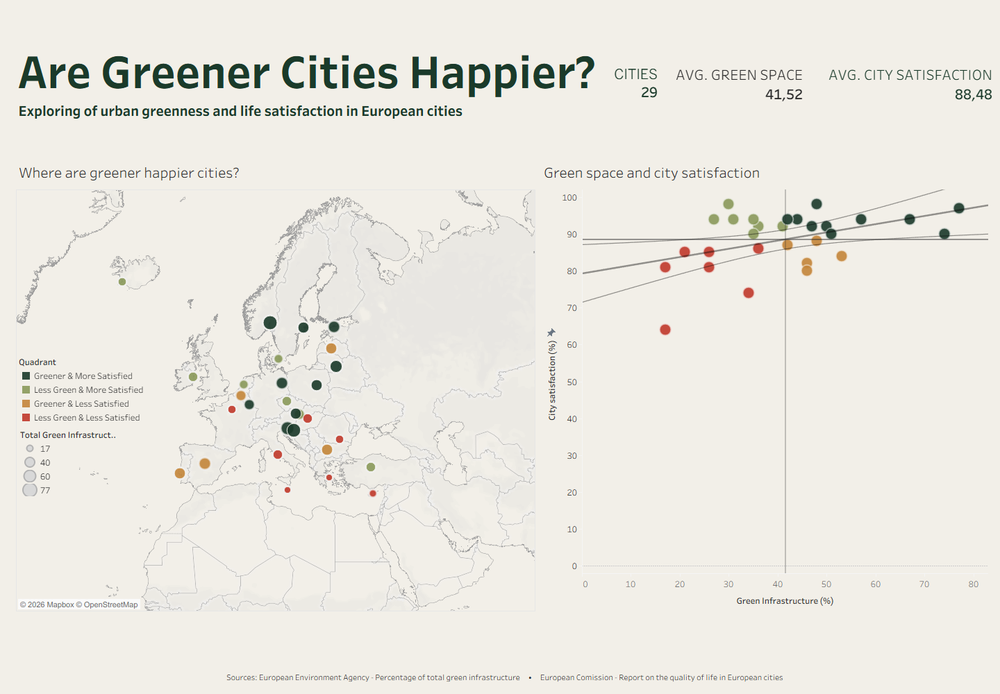
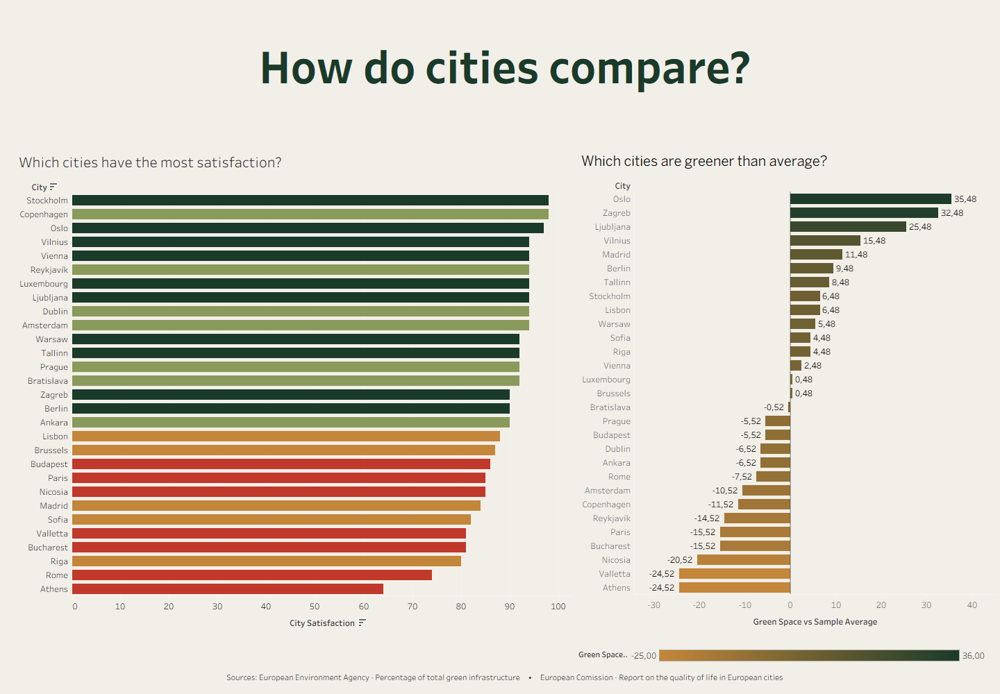

# Are Greener Cities Happier?

> **Executive Summary:** This project explores the relationship between urban green infrastructure and residents’ satisfaction with city life across 29 European capitals. Using Python, I cleaned and combined environmental and survey datasets, conducted exploratory data analysis, and calculated Pearson correlations to investigate how different measures of greenery relate to satisfaction. I then developed an interactive Tableau dashboard to visualize geographical patterns, compare cities, and identify exceptions to the overall trend. The findings reveal a positive association between total green infrastructure and city satisfaction, but also show that greater greenery does not automatically correspond to higher satisfaction.

## Project Overview

Does a greener city mean a happier population?

Urban greenery is often associated with a better quality of life, but the relationship between greenery and residents’ satisfaction is not necessarily straightforward.

The goal of this project was to investigate how urban greenery relates to residents’ satisfaction with living in their city, combining environmental indicators with survey responses to explore patterns across European capitals.

The project follows the data analytics workflow, from data cleaning and exploratory analysis in Python to interactive data visualization in Tableau.

### Key Takeaways

- **The relationship:** Total green infrastructure and city satisfaction show a positive correlation in the analyzed sample.
- **The differences:** Individual cities vary in both greenery and satisfaction. Some cities with less green infrastructure report satisfaction levels comparable to, or higher than, greener cities.
- **The limitations:** The analysis covers 29 European capitals and cannot establish causation or represent every European city.

The findings suggest a positive but non-universal relationship: green infrastructure may contribute to the urban living experience, but it is only one part of a broader picture.

---

## Dashboard Preview

### Page 1 — Overview



Provides a geographical overview of the selected cities and explores the relationship between greenery and city satisfaction.

The dashboard uses a map, a scatterplot, and comparisons with sample averages to reveal overall patterns and highlight cities that stand out.

**Key questions**

- How are greenery and city satisfaction distributed across Europe?
- Do cities with more green infrastructure tend to report higher satisfaction?
- Which cities fall above or below the sample averages?
- Are there cities that do not follow the overall trend?

### Page 2 — City Comparison



Focuses on differences between individual cities, allowing closer comparisons of their satisfaction levels and green infrastructure.

The dashboard helps put rankings into context by examining how each city's greenery compares with the sample average.

**Key questions**

- Which cities report the highest and lowest city satisfaction?
- Which cities have more or less green infrastructure than average?
- Does a city's greenery position correspond to its satisfaction ranking?
- What do differences between cities reveal about the limitations of a simple greenery–satisfaction relationship?

---

## Interactive Dashboard

The Tableau dashboards are designed to explore the data from two perspectives: the overall pattern across Europe and the differences between individual cities.

### Exploring the Geographical Distribution

The map shows how the selected cities are distributed geographically. Different colours distinguish combinations of greenery and satisfaction, while marker size represents the amount of green infrastructure.

Several cities in central and northern Europe appear among the greener, more satisfied cities. However, this pattern is not universal across the sample.

### Exploring the Relationship

The scatterplot provides a more direct look at the relationship between green infrastructure and city satisfaction. Each point represents one city.

Average reference lines divide the chart into four quadrants, showing which cities are above or below the sample averages. The trendline indicates an overall upward trend.

Despite this positive direction, the individual cities reveal exceptions. Some cities with less green infrastructure are just as satisfied as greener cities, or even more satisfied.

### Comparing City Satisfaction

The city ranking highlights the three highest and three lowest satisfaction scores.

It demonstrates that satisfaction varies across cities, but the ranking alone does not explain why some cities report greater satisfaction than others.

When compared with the amount of green infrastructure, the ranking becomes more nuanced: greener cities do not always rank higher in satisfaction.

### Comparing Green Infrastructure with the Average

This comparison identifies cities with more or less green infrastructure than the sample average.

The cities that stand out in greenery do not necessarily occupy the same positions in the satisfaction ranking. This reinforces the central finding that greater green infrastructure does not automatically correspond to greater city satisfaction.

---

## Technical Approach

### 1. Data Exploration

Explored the available environmental and survey datasets to understand the available measures of urban greenery and residents’ satisfaction.

The data includes:

- Urban green space.
- Total green infrastructure.
- Urban tree cover.
- Satisfaction with living in the city.
- Satisfaction with green spaces.

The environmental data provides measures of urban greenery, while the Quality of Life in European Cities survey provides residents’ reported satisfaction.

### 2. Data Cleaning and Preparation

Used Python and Pandas to clean, transform, and combine the datasets.

The preparation included:

- Standardizing city names to enable matching between datasets.
- Cleaning and preparing the relevant environmental and survey indicators.
- Combining the datasets into a consolidated analysis table.
- Restricting the analysis to the 29 capitals for which the required indicators could be matched.

### 3. Feature Engineering

Created satisfaction measures by combining positive survey response categories.

- **City satisfaction:** The combined share of respondents who strongly or somewhat agree that they are satisfied living in their city.
- **Green-space satisfaction:** The combined share of respondents who are very or rather satisfied with green spaces in their city.

These indicators represent reported satisfaction, rather than a direct measure of happiness or mental health.

### 4. Exploratory Analysis and Correlation

Used Python to compare the greenery and satisfaction indicators across cities and calculate Pearson correlation coefficients.

The analysis examined the linear relationships between the different greenery measures, city satisfaction, and green-space satisfaction.

The results showed that the strength and direction of the relationship depend on the indicator used.

| Variables compared | Pearson correlation |
|---|---:|
| Total green infrastructure and city satisfaction | +0.444 |
| Urban tree cover and city satisfaction | +0.344 |
| Urban green space and city satisfaction | −0.006 |
| Green-space satisfaction and city satisfaction | +0.803 |

The findings indicate a positive association between total green infrastructure and city satisfaction, while the urban green-space measure shows virtually no linear correlation with city satisfaction in this sample.

Correlation describes association and does not establish causation.

### 5. Tableau Data Preparation

Prepared a consolidated CSV dataset for Tableau containing the relevant city-level greenery and satisfaction indicators.

The exported dataset was used as the foundation for the dashboard visualizations and comparisons.

### 6. Dashboard Development

Connected the prepared data to Tableau and developed two dashboard pages.

The visualizations include:

- A geographical map showing the distribution of greenery and satisfaction.
- A scatterplot with average reference lines and a trendline.
- City satisfaction rankings.
- Comparisons of green infrastructure against the sample average.
- Visual distinctions that help identify patterns and exceptions.

The dashboards were designed to move from an overall view of the relationship to a closer examination of individual cities.

---

## Tools & Technologies

| Tool | Purpose |
|---|---|
| Python | Data cleaning, transformation, and analysis |
| Pandas | Data manipulation and dataset merging |
| Jupyter Notebook | Exploratory data analysis and documentation |
| Pearson correlation | Measuring linear associations between variables |
| Tableau | Interactive dashboards and data visualization |


---

## Project Outcome

The final deliverable is a two-page Tableau dashboard supported by a Python-based analytical workflow.

The project combines environmental data with survey responses to explore whether cities with more green infrastructure also tend to have more satisfied residents.

The results reveal a positive overall relationship between total green infrastructure and city satisfaction. However, the city-level comparisons show that this relationship is not universal.

The map and scatterplot help identify the broad pattern, while the rankings and comparisons against the sample average reveal important exceptions.

The main outcome is a more nuanced understanding of the relationship between urban greenery and satisfaction: greenery may be one contributing factor, but it does not independently explain why residents are more or less satisfied with their city.

---

## Project Structure

```text
Greener Cities/
├── data/
│   ├── cleaned data/
│   │   ├── air_quality_satisfaction.csv
│   │   ├── city_health.csv
│   │   ├── city_satisfaction.csv
│   │   ├── green_space_cleaned.csv
│   │   ├── green_space_satisfaction.csv
│   │   ├── quality_life_cleaned.csv
│   │   └── survey_master.csv
│   ├── data_for_tableau/
│   │   └── tableau_master_green-space.csv
│   └── raw/
│       ├── percentage-of-total-green-infrastructure.csv
│       └── quality-of-life-and-city.csv
├── documentation/
│   ├── Final Presentation/
│   │   └── Greener-Happier-Cities-Presentation.pptx
│   ├── MVP/
│   │   ├── Are greener cities happier.pptx
│   │   └── Notes.txt
│   └── Pitch/
│       ├── Are greener cities happier.pptx
│       └── Pitch text.txt
├── notebooks/
│   ├── analyzing-the-data.ipynb
│   └── exploration-cleanup.ipynb
├── tableau/
│   └── Greener_Happier_Cities_Sheets.twbx
├── visuals/
│   ├── Are_Greener_Cities_Happier_Dashboard_1.png
│   └── Are_Greener_Cities_Happier_Dashboard_2.png
└── README.md
```


## Limitations

The results should be interpreted in light of several limitations:

- **Sample size:** The analysis covers 29 European capitals and cannot represent every European city.
- **Correlation versus causation:** The analysis identifies associations but cannot establish whether greenery causes higher satisfaction.
- **Different greenery measures:** Urban green space, tree cover, and total green infrastructure capture different aspects of the urban environment.
- **Accessibility and quality:** Green coverage does not show whether green spaces are accessible, safe, attractive, or well maintained.
- **Other influences:** Housing, income, transport, safety, climate, and other aspects of city life may also affect satisfaction.
- **Data comparability:** Environmental and survey data may differ in reference year, definitions, and geographical boundaries.
- **Satisfaction as a proxy:** Satisfaction with living in a city is not a direct measure of happiness or mental health.

---

## Conclusion

At an overall level, the analysis reveals a positive relationship between total green infrastructure and city satisfaction in the 29-city sample. Looking at individual cities, however, makes the picture more complex.

Some greener cities report high satisfaction, but some cities with less green infrastructure are just as satisfied or even more satisfied. The amount of greenery alone does not explain these differences.

The findings suggest a **positive but non-universal relationship** between green infrastructure and city satisfaction. Green infrastructure may contribute to a better urban living experience, but this analysis cannot establish that it causes higher satisfaction.

Ultimately, a greener city is not automatically a happier city. Understanding how greenery relates to residents’ satisfaction is one part of a broader question about the places we build and the quality of life they offer.

## Data Sources & Attribution

This project combines environmental indicators of urban greenery with survey data on quality of life in European cities.

- **Quality of Life in European Cities:** Survey data on satisfaction with city life and green spaces.
- **Environmental greenery data:** Indicators covering urban green space, total green infrastructure, and urban tree cover.

Please consult the original datasets and their documentation for full definitions, reference periods, and attribution requirements.
